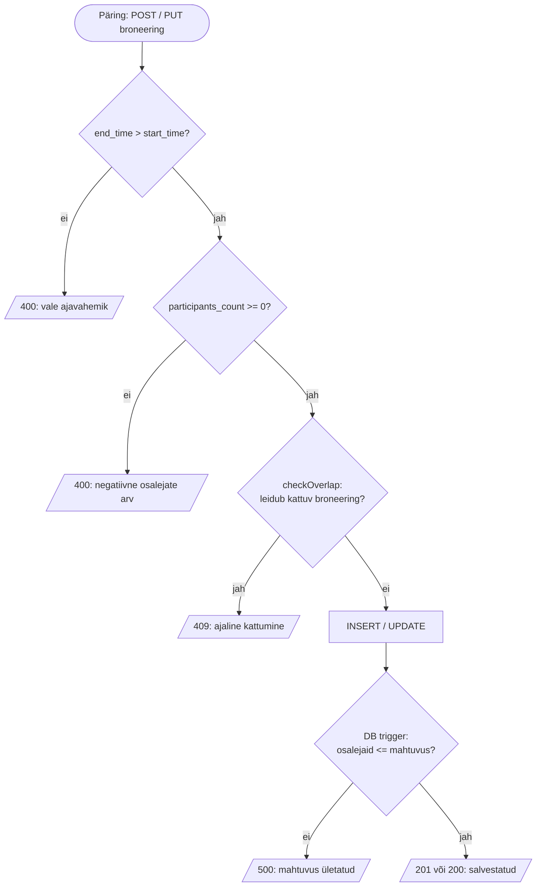

# Algoritmi kirjeldus – broneeringu valideerimine ja ajalise kattumise kontroll

Süsteemi keskne algoritm otsustab, kas uue (või muudetud) broneeringu võib
andmebaasi salvestada. Algoritm koosneb neljast järjestikusest kontrollist
(ärireeglid 1–4, vt [logical_design.md](logical_design.md)), millest kõige
sisukam on **ajalise kattumise kontroll** (`checkOverlap()` failis
[app/server.js](app/server.js)).

## 1. Sisend ja väljund

**Sisend** (HTTP päringu keha, `POST /api/bookings` või `PUT /api/bookings/:id`):

| Väli | Tüüp | Näide |
|------|------|-------|
| `classroom_id` | täisarv | `3` |
| `organizer_id` | täisarv | `7` |
| `lesson_type_id` | täisarv | `1` |
| `booking_date` | kuupäev `YYYY-MM-DD` | `2026-10-20` |
| `start_time` | kellaaeg `HH:MM` | `10:00` |
| `end_time` | kellaaeg `HH:MM` | `11:30` |
| `participants_count` | täisarv ≥ 0 | `24` |
| `status` | `planned` / `completed` / `cancelled` | `planned` |
| `id` (ainult muutmisel) | täisarv, URL-ist | `12` |

**Väljund** (HTTP vastus):

| Olukord | Kood | Vastus |
|---------|------|--------|
| Kõik kontrollid läbitud | `201` (lisamine) / `200` (muutmine) | `{ id }` / `{ ok: true }` |
| Lõppaeg ≤ algusaeg | `400` | `{ error: 'Lõppaeg peab olema hilisem kui algusaeg' }` |
| Osalejate arv < 0 | `400` | `{ error: 'Osalejate arv ei saa olla negatiivne' }` |
| Klass on sel ajal juba broneeritud | `409` | `{ error: 'See klass on sel ajal juba broneeritud (ajaline kattumine)' }` |
| Muudetavat broneeringut ei leitud | `404` | `{ error: 'Broneeringut ei leitud' }` |
| Osalejaid on rohkem, kui klassi mahub (DB trigger) | `500` | `{ error: 'Osalejate arv ületab klassi mahtuvuse (capacity)' }` |

## 2. Algoritmi sammud

1. **Loe sisend** päringu kehast (ja muutmisel `id` URL-ist).
2. **Kontrolli ajavahemikku** (`validateTimeRange`): kui `end_time <= start_time`,
   lõpeta veaga `400`.
3. **Kontrolli osalejate arvu** (`validateParticipants`): kui `participants_count < 0`,
   lõpeta veaga `400`.
4. **Kontrolli ajalist kattumist** (`checkOverlap`): otsi andmebaasist sama klassi
   ja sama kuupäeva broneeringuid, mis pole tühistatud ja mille ajavahemik
   lõikub uue omaga. Muutmisel jäetakse broneering ise otsingust välja.
   Kui leidub vähemalt üks, lõpeta veaga `409`.
5. **Salvesta** broneering (`INSERT` või `UPDATE`).
6. **Andmebaasi viimane kaitseliin**: `CHECK`-piirangud kordavad samme 2–3 ja
   trigger `trg_booking_capacity_*` kontrollib, et osalejate arv ei ületaks
   klassi mahtuvust. Rikkumise korral tühistab andmebaas käsu.
7. **Tagasta** õnnestumise vastus.

### Pseudokood

```text
FUNKTSIOON salvestaBroneering(b, muudetavId = TÜHI):
    KUI b.end_time <= b.start_time:
        TAGASTA 400 "Lõppaeg peab olema hilisem kui algusaeg"
    KUI b.participants_count < 0:
        TAGASTA 400 "Osalejate arv ei saa olla negatiivne"
    KUI kattub(b.classroom_id, b.booking_date, b.start_time, b.end_time, muudetavId):
        TAGASTA 409 "See klass on sel ajal juba broneeritud"
    KUI muudetavId on TÜHI:
        id := INSERT b
        TAGASTA 201 { id }
    MUIDU:
        read := UPDATE b WHERE id = muudetavId
        KUI read = 0: TAGASTA 404 "Broneeringut ei leitud"
        TAGASTA 200 { ok: true }

FUNKTSIOON kattub(klass, kuupäev, uusAlgus, uusLõpp, välistaId):
    LEIA broneeringud x, kus
        x.classroom_id = klass
        JA x.booking_date = kuupäev
        JA x.status <> 'cancelled'
        JA x.start_time < uusLõpp
        JA x.end_time   > uusAlgus
        JA (välistaId on TÜHI VÕI x.id <> välistaId)
    TAGASTA (leitud ridu > 0)
```

### Plokkskeem



## 3. Miks kattumise tingimus töötab

Kaks poolavatud ajavahemikku `[A_algus, A_lõpp)` ja `[B_algus, B_lõpp)`
kattuvad **parajasti siis**, kui

```text
A_algus < B_lõpp  JA  A_lõpp > B_algus
```

Põhjendus: vahemikud **ei** kattu ainult kahel juhul. Kas A lõpeb enne B
algust või täpselt sel hetkel (`A_lõpp <= B_algus`), või A algab B lõpus või
pärast seda (`A_algus >= B_lõpp`). Tingimus on nende kahe juhu eitus.
De Morgani seaduse järgi annab see täpselt ülaltoodud kuju. Seetõttu piisab
ühest SQL-päringust ja eraldi juhtumite (sees, ümber, vasakult, paremalt)
läbivaatamist pole vaja.

**Näited** (olemasolev broneering 10:00–11:30):

| Uus broneering | `10:00 < uusLõpp` | `11:30 > uusAlgus` | Kattub? |
|----------------|-------------------|--------------------|---------|
| 09:00–10:00 | `10:00 < 10:00` ✗ | ✓ | **ei** (lõpeb täpselt alguses) |
| 09:00–10:30 | ✓ | ✓ | **jah** (vasakult sisse) |
| 10:30–11:00 | ✓ | ✓ | **jah** (täielikult sees) |
| 09:00–12:00 | ✓ | ✓ | **jah** (katab ümbert) |
| 11:00–12:00 | ✓ | ✓ | **jah** (paremalt sisse) |
| 11:30–13:00 | ✓ | `11:30 > 11:30` ✗ | **ei** (algab täpselt lõpus) |

Range võrdlus (`<`, `>`) lubab broneeringuid järjestikku panna: üks tund
lõpeb 11:30 ja järgmine algab samas klassis 11:30.

## 4. Erijuhud

- **Tühistatud broneeringud** (`status = 'cancelled'`) ei blokeeri aega.
  Tühistatud tunni asemele saab teha uue broneeringu.
- **Muutmine**: `excludeId` jätab muudetava broneeringu otsingust välja. Muidu
  kattuks broneering iseendaga ja selle kellaaega ei saaks kunagi muuta.
- **Erinevad klassid või päevad** ei mõjuta teineteist, sest päring filtreerib
  `classroom_id` ja `booking_date` järgi.
- **Üle südaöö** ulatuvaid broneeringuid süsteem ei toeta. Selle välistab
  reegel `end_time > start_time`, mis kehtib ühe kuupäeva piires.

## 5. Keerukus

Päring kasutab liitindeksit `idx_booking_classroom_date (classroom_id, booking_date)`
(vt [schema.sql](schema.sql)). Andmebaas loeb ainult ühe klassi ühe päeva
broneeringud (tavaliselt alla 10 rea), mitte kogu tabelit. Ajaline keerukus on
seega `O(log n + k)`, kus `n` on broneeringute koguarv ja `k` on selle klassi
broneeringute arv sel päeval.

## 6. Teadaolev piirang

Kattumise kontroll (samm 4) ja salvestamine (samm 5) on kaks eraldi päringut ja
ei toimu ühes tehingus. Kui kaks kasutajat broneerivad täpselt samal hetkel
sama aja, võivad mõlemad kontrolli läbida. Õppeprojekti mahus on see risk
väike. Täieliku lahenduse annaks tehing koos `SELECT ... FOR UPDATE`-ga või
andmebaasi tasemel kontroll.

## 7. Testimine

DB-sõltumatud sammud 2–3 on kaetud üksustestidega failis
[app/test/validation.test.js](app/test/validation.test.js) (`npm test`).
Sammu 4 (`checkOverlap`) on testitud käsitsi käivitatud MariaDB vastu, sest see
vajab andmebaasi (vt [AGENTS.md](AGENTS.md), punkt 4).
