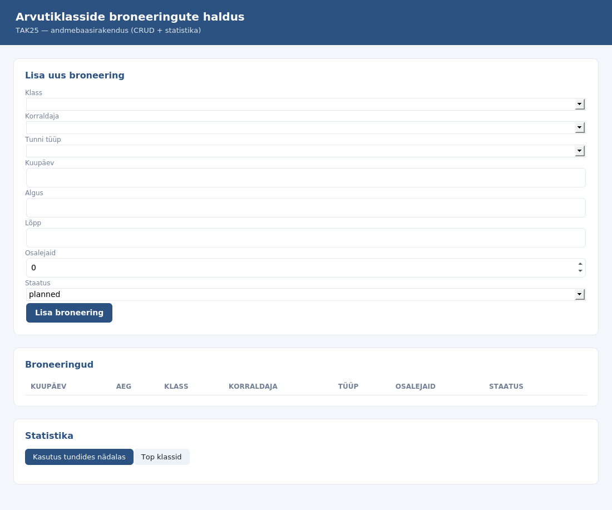
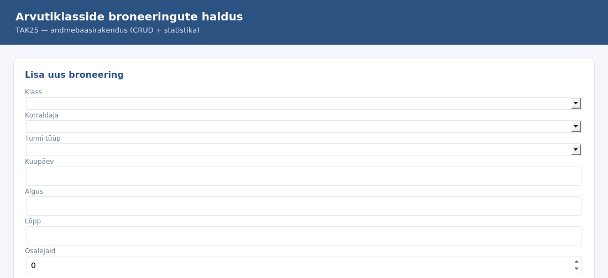
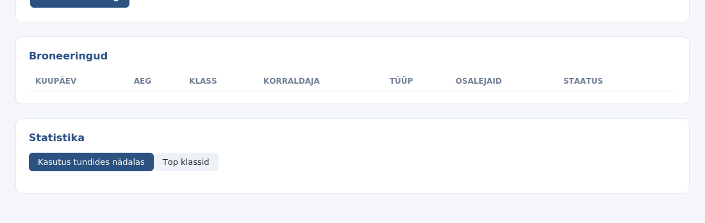

# Arvutiklasside kasutuse andmebaasirakendus

**Grupp:** TAK25
**Tehnoloogia:** Node.js (Express) + MariaDB
**Andmemudel:** classroom, user_or_group, lesson_type, booking, booking_participant (N..M vahetabel)

Rakendus võimaldab hallata arvutiklasside broneeringuid: vaadata, lisada, muuta ja
kustutada broneeringuid ning näha statistikat (klasside kasutus tundides nädalas + top klassid).

---

## Eeltingimused

- Node.js 18+ (testitud v22)
- MariaDB või MySQL server

## 1. Andmebaasi loomine

```bash
# Loo skeem (tabelid, triggerid, vaated)
mysql -u root < schema.sql
```

## 2. Kasutajate ja õiguste loomine

```bash
# Loo admin/viewer rollid + rakenduse kasutaja
mysql -u root < permissions.sql

# Loo rakenduse kasutaja (kui pole veel loodud)
mysql -u root -e "CREATE USER IF NOT EXISTS 'app_user'@'%' IDENTIFIED BY 'app_pass_123'; \
  GRANT SELECT, INSERT, UPDATE, DELETE ON arvutiklassid.* TO 'app_user'@'%'; FLUSH PRIVILEGES;"
```

## 3. Sõltuvuste paigaldamine

```bash
cd app
npm install
```

## 4. Andmete importimine (CSV + JSON + XML)

```bash
# app/ kaustast
DB_USER=app_user DB_PASS=app_pass_123 node import.js
```

Impordib:
- `import/classes.csv` → `classroom`
- `import/teachers.json` → `user_or_group`
- `import/bookings.xml` → `booking` + `lesson_type` + `booking_participant`

## 5. Rakenduse käivitamine

```bash
# app/ kaustast
DB_USER=app_user DB_PASS=app_pass_123 PORT=3000 node server.js
```

Ava brauseris: **http://localhost:3000**

## 6. Andmete eksportimine (CSV + JSON)

```bash
# app/ kaustast
DB_USER=app_user DB_PASS=app_pass_123 node export.js
```

Loob:
- `export/bookings_summary.csv` — broneeringute koond kuu kaupa
- `export/top5_classes.json` — top 5 kõige kasutatumad klassid

---

## Konfiguratsioon (keskkonnamuutujad)

| Muutuja | Vaikeväärtus | Selgitus |
|---------|--------------|----------|
| `DB_HOST` | `127.0.0.1` | andmebaasi host |
| `DB_PORT` | `3306` | port |
| `DB_USER` | `root` | kasutaja |
| `DB_PASS` | *(tühi)* | parool |
| `DB_NAME` | `arvutiklassid` | andmebaasi nimi |
| `PORT` | `3000` | veebiserveri port |

---

## Funktsionaalsus (CRUD + statistika)

- **Vaatamine** — kõik broneeringud tabelina (kuupäev, aeg, klass, korraldaja, tüüp, osalejad, staatus)
- **Lisamine** — uus broneering vormi kaudu koos valideerimisega
- **Muutmine** — olemasoleva broneeringu redigeerimine
- **Kustutamine** — broneeringu eemaldamine (kinnitusega)
- **Statistika** — klasside kasutus tundides nädalas (tulpdiagramm) + top 5 klassid

### Valideerimine (ärireeglid)
- lõppaeg peab olema hilisem kui algusaeg (CHECK + API)
- osalejate arv ei tohi olla negatiivne (CHECK + API)
- osalejaid ei tohi olla rohkem kui klassi mahtuvus (TRIGGER)
- sama klassi broneeringud ei tohi samal kuupäeval ajaliselt kattuda (API tase)

---

## Ekraanipildid

### Ülevaade (vorm + broneeringute list + statistika)


### Vorm ja broneeringute nimekiri


### Statistika


---

## Projekti struktuur

```
project/
├── schema.sql                  # DDL (CASE-st genereeritud struktuur)
├── erd.dbml                    # DBML lähtefail (dbdiagram.io CASE-vahend)
├── erd_crowsfoot.png/.pdf      # ERD Crow's Foot diagramm
├── uml_class.png/.pdf          # UML klassidiagramm
├── logical_design.md           # loogilise disaini kirjeldus
├── permissions.sql / .md       # õigused (rollid, GRANT/REVOKE)
├── app/
│   ├── server.js               # Express CRUD server
│   ├── import.js               # CSV+JSON+XML import
│   ├── export.js               # CSV+JSON eksport
│   ├── db.js                   # DB ühendus
│   ├── package.json
│   └── public/
│       ├── index.html          # frontend (CRUD UI + statistika)
│       └── screenshots/
├── import/                     # lähtefailid (classes.csv, teachers.json, bookings.xml)
├── export/                     # eksporditud failid
└── backup/                     # backup + taastamise tõendus
    ├── backup_YYYY-MM-DD.sql
    └── restore_proof.txt
```
